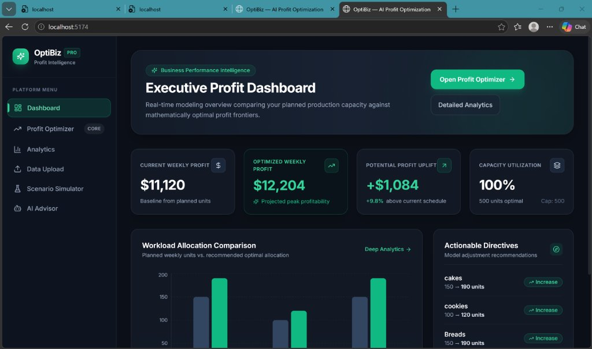
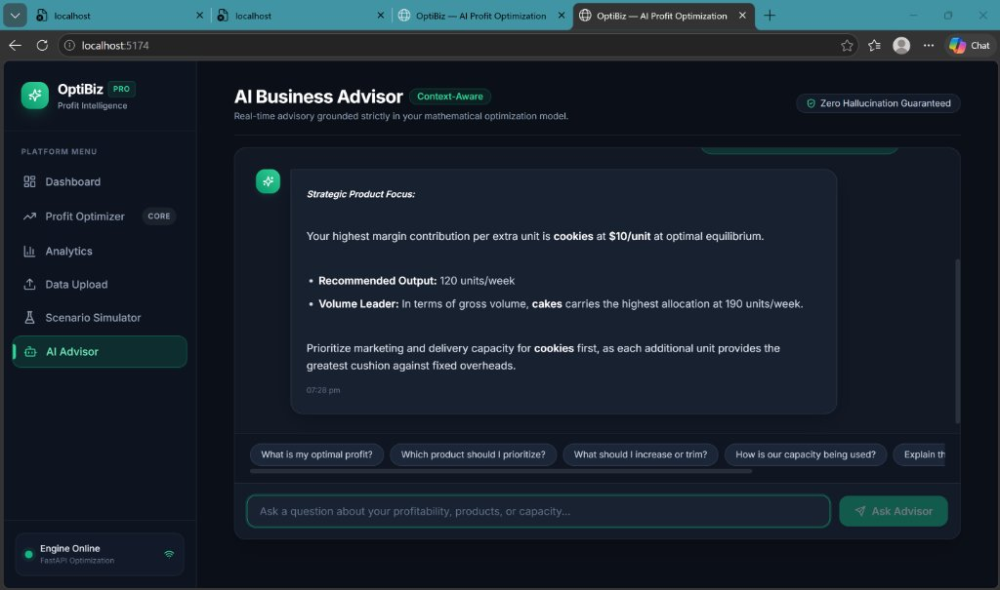
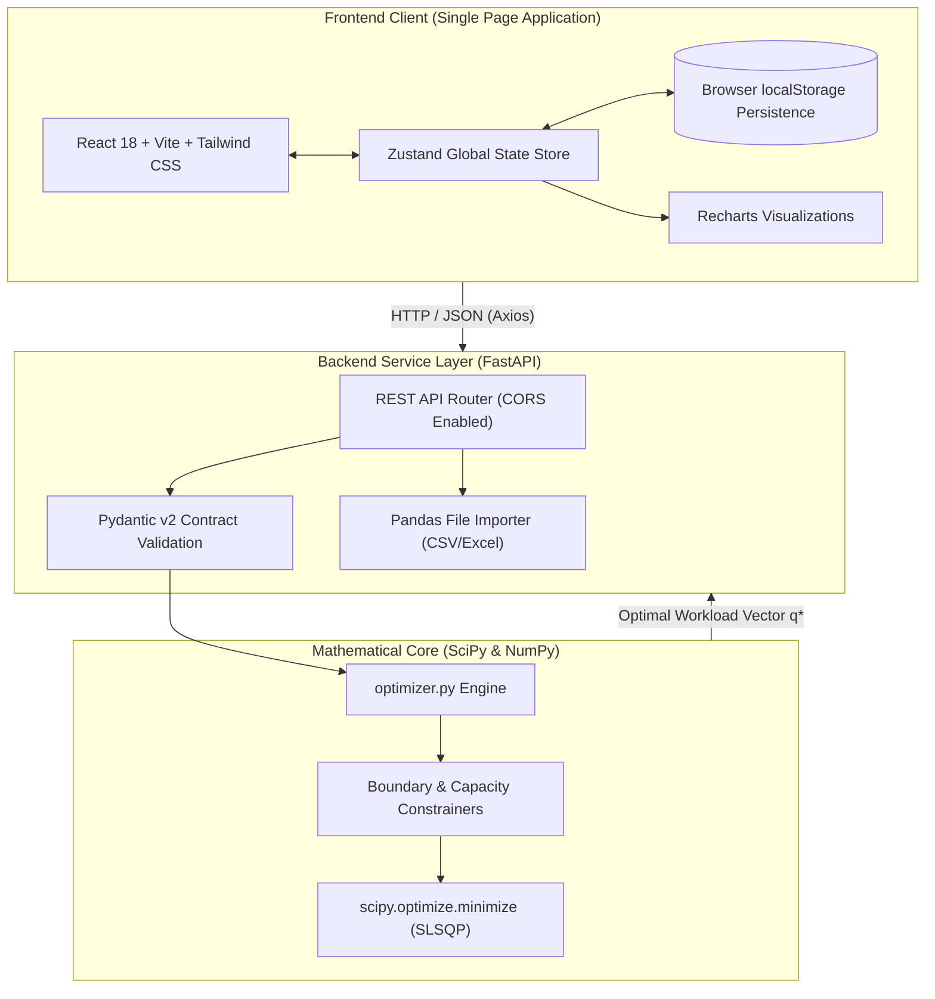

# OptiBiz

### AI-Powered Workload Intelligence & Profit Optimization for Micro and Small Businesses

[](https://www.python.org/)
[](https://fastapi.tiangolo.com/)
[](https://react.dev/)
[](https://www.typescriptlang.org/)
[](https://scipy.org/)
[](https://tailwindcss.com/)
[](https://ipindia.gov.in/)
[](LICENSE)

---

## 📌 Executive Summary

**OptiBiz** is an open-source business intelligence and profit optimization platform engineered specifically for micro and small enterprises (MSMEs), service agencies, craft manufacturers, and boutique consultancies.

Unlike conventional accounting software that merely aggregates historical revenue, OptiBiz acts as a forward-looking decision engine. It combines a constrained, calculus-based quadratic profit model with an intuitive software interface to help non-technical business owners determine **exactly how many units of each product or service to deliver each week** to maximize net take-home profit while preventing operational burnout and bottleneck drag.

---

## ⚖️ Patent Information

> [!IMPORTANT]  
> **Statutory Notice on Intellectual Property:**  
> The underlying calculus-based workload intelligence model and mathematical framework utilized in OptiBiz are subject to a published patent application under the Indian Patent Office.

- **Patent Application Title:**  
  *System and Method for Calculus-Based Workload Intelligence and Profit Optimization for Micro and Small Businesses*
- **Indian Patent Application Number:** `202641081593`
- **Filing Date:** `02 July 2026`
- **Application Status:** **Patent Application Filed and Published**
- **Clarification:** This disclosure explicitly references a *published patent application* currently undergoing statutory examination by the patent office. This document does not claim or imply that a patent has been granted.

---

## 🎯 The Problem: The Hidden Traps in Small Business Growth

Micro and small businesses consistently encounter three critical operational failure modes when trying to scale:

1. **The "Volume Equals Profit" Fallacy**: Business owners often assume that selling more units of their highest-priced product yields the greatest net profit. In reality, delivery friction escalates non-linearly.
2. **Individual Overload Penalty ($a_i$)**: As production of a single product scales up, individual strain mounts—labor fatigue, premium overtime costs, supply expedited fees, and rework rates increase rapidly, causing diminishing returns.
3. **Shared Resource Bottlenecks ($s$)**: When multiple products compete simultaneously for shared facilities, administrative oversight, packaging space, and delivery bandwidth, aggregate cross-product congestion degrades overall operating margins.
4. **Cognitive Burden & Inaccessible Math**: Constrained non-linear optimization algorithms have historically required enterprise software, specialized consultants, or PhD-level mathematical tooling, leaving small business owners reliant on gut feeling and static spreadsheets.

---

## 💡 The Solution: Calculus-Based Profit Optimization

OptiBiz bridges the gap between industrial operations research and everyday business management:

- **Mathematical Rigor**: Formulates the multi-product scheduling problem as a concave quadratic objective function solved deterministically via **Sequential Least Squares Programming (SLSQP)**.
- **Non-Technical Language**: Eliminates intimidating mathematical notation in favor of intuitive terms ($m_i \to$ *Profit earned per unit*, $a_i \to$ *Workload penalty coefficient*, $s \to$ *Shared resource penalty coefficient*).
- **Multi-Currency Support**: First-class support for **INR (₹)**, **USD ($)**, **EUR (€)**, **GBP (£)**, **CAD (CA$)**, and **AUD (A$)**.
- **Context-Aware AI Guidance**: Translates numerical solver outputs into plain-language actionable recommendations (e.g., *"Scale up cookies by +20 units; taper bread production by -15 units to eliminate packaging bottlenecks"*).

---

## 📐 Mathematical Formulation

OptiBiz models aggregate weekly net profit $P(\mathbf{q})$ across $n$ distinct products or services as a continuous concave quadratic objective:

$$\max_{\mathbf{q}} P(\mathbf{q}) = \sum_{i=1}^{n} m_i q_i - \sum_{i=1}^{n} a_i q_i^2 - s \left( \sum_{i=1}^{n} q_i \right)^2$$

### Subject to Operational Constraints:

1. **Non-Negativity Constraint**:
   $$q_i \ge 0 \quad \forall i \in \{1, \dots, n\}$$
2. **Individual Market Demand Ceilings**:
   $$q_i \le D_i^{\max} \quad \forall i \in \{1, \dots, n\}$$
3. **Aggregate Production Capacity Ceiling**:
   $$\sum_{i=1}^{n} q_i \le C_{\text{total}}$$

### Mathematical Parameter Definitions:

| Parameter | Mathematical Role | Plain Business Translation |
|---|---|---|
| $q_i$ | Decision Variable | Weekly output quantity for product $i$ |
| $m_i$ | Linear Coefficient | **Profit earned per unit** (Unit Selling Price minus Direct Variable Cost) |
| $a_i$ | Quadratic Single Penalty | **Workload penalty coefficient** (Product-specific overtime/fatigue drag) |
| $s$ | Quadratic Coupled Penalty | **Shared resource penalty coefficient** (System-wide coordination bottleneck) |
| $D_i^{\max}$ | Upper Box Bound | **Maximum weekly demand** that the market will absorb |
| $C_{\text{total}}$ | Linear Inequality Bound | **Available weekly capacity** (Total team throughput limit) |

### First-Order Marginal Return Profile:

The marginal profit contribution for product $i$ at any workload vector $\mathbf{q}$ is given analytically by:

$$\frac{\partial P}{\partial q_i} = m_i - 2 a_i q_i - 2 s \sum_{k=1}^{n} q_k$$

At optimal allocation $\mathbf{q}^*$, Karush-Kuhn-Tucker (KKT) conditions guarantee that all unconstrained active products yield equal marginal return net of capacity shadow prices.

---

## 🖼️ Application Screenshots

### Executive Profit Dashboard
*High-level performance monitoring comparing planned weekly baseline against mathematically optimal profit frontiers with capacity utilization meters and actionable directives.*



---

### Context-Aware AI Business Advisor
*Zero-hallucination interactive advisory translating solver matrices into natural-language strategic recommendations.*



---

## 🏛️ System Architecture



---

## 📦 Core Product Modules

OptiBiz is organized into five functional modules:

### 1. Profit Optimization Engine `[Implemented]`
- Interactive multi-product parameter configuration with zero required mathematical background.
- Real-time client-side input validation and error feedback.
- Automated client-side persistence via `localStorage` with explicit save-state tracking (`Saved to browser` / `Saving...`).
- Clean first-time empty state with an explicit, optional **"Load Demo Business Data"** sandbox loader.
- SciPy-backed numerical solver that respects individual demand caps and aggregate team capacity limits.

### 2. Business Analytics Dashboard `[Implemented]`
- **100% Data-Driven**: Zero mock metrics or invented global optimum claims.
- **Planned vs. Optimal Workload**: Side-by-side grouped bar chart illustrating recommended shifts in weekly output.
- **Production Mix Distribution**: Donut chart detailing operational bandwidth allocation per product.
- **Marginal Profit Profile**: Multi-axis radar visualization graphing $\frac{\partial P}{\partial q_i}$ at optimal equilibrium.
- **Full Quadratic Mathematical Decomposition**: Tabular audit breaking net profit down into:
  $$\text{Net Profit} = \text{Gross Contribution} - \text{Individual Strain} - \text{Shared Overhead}$$

### 3. Strategic Scenario Simulator `[Implemented]`
- Runs what-if strategic modeling using the business owner's **actual configured product catalog**.
- Compares two distinct operating strategies side-by-side (e.g., Baseline Operations vs. Aggressive Capacity Expansion).
- Calculates profit variance, optimal allocation shifts, and identifies the superior strategic path.

### 4. Context-Aware AI Business Advisor `[Implemented]`
- In-browser conversational intelligence grounded strictly in the user's active optimization result.
- Provides immediate answers regarding optimal output, high-margin priorities, and bottleneck alleviation.
- **Guaranteed Zero Hallucination**: Directly references validated solver output and model coefficients.

### 5. CSV & Excel Data Importer `[Implemented]`
- Bulk product catalog ingestion supporting `.csv`, `.xlsx`, and `.xls` formats.
- Heuristic column-to-parameter mapping suggestions for quick onboarding.
- One-click sample CSV generation.

---

## 🛠️ Technology Stack

### Frontend Architecture
- **Framework**: [React 18.3.1](https://react.dev/) with [TypeScript 5.4.5](https://www.typescriptlang.org/)
- **Build Tooling**: [Vite 6.4.5](https://vitejs.dev/) (fast Hot Module Replacement & Rollup bundling)
- **Styling**: [Tailwind CSS 3.4.6](https://tailwindcss.com/) & [PostCSS 8.4.39](https://postcss.org/)
- **State Management**: [Zustand 4.5.4](https://github.com/pmndrs/zustand) with automated `localStorage` persistence
- **Visualizations**: [Recharts 2.12.7](https://recharts.org/) (Responsive SVG Bar, Donut, and Radar charts)
- **Icons**: [Lucide React 0.395.0](https://lucide.dev/)
- **HTTP Client**: [Axios 1.7.2](https://axios-http.com/)

### Backend Architecture
- **Web Framework**: [FastAPI 0.115.0](https://fastapi.tiangolo.com/) (Asynchronous ASGI server)
- **ASGI Server**: [Uvicorn 0.30.6](https://www.uvicorn.org/)
- **Numerical Optimization**: [SciPy 1.13.1](https://scipy.org/) (`scipy.optimize.minimize` via SLSQP algorithm)
- **Vector Mathematics**: [NumPy 1.26.4](https://numpy.org/)
- **Data Ingestion**: [Pandas 2.2.2](https://pandas.pydata.org/) & [openpyxl 3.1.5](https://openpyxl.readthedocs.io/)
- **Schema Validation**: [Pydantic v2 2.8.2](https://docs.pydantic.dev/)
- **Automated Testing**: [Pytest 8.3.2](https://pytest.org/) & [pytest-asyncio 0.23.8](https://github.com/pytest-dev/pytest-asyncio)

---

## 🔌 API Reference

FastAPI automatically serves interactive OpenAPI documentation at `http://localhost:8000/api/docs`.

### Core Endpoints

#### 1. Profit Optimization
- **Endpoint**: `POST /api/optimize`
- **Request Body**:
  ```json
  {
    "s": 0.003,
    "capacity": 500,
    "products": [
      {
        "name": "Custom Web Engineering",
        "m_i": 240,
        "a_i": 0.70,
        "planned_qty": 15,
        "max_demand": 35
      }
    ]
  }
  ```
- **Response**: Returns solver convergence status, current planned profit, optimal projected profit, profit uplift, and product-by-product recommended quantities with marginal returns.

#### 2. Scenario Comparison
- **Endpoint**: `POST /api/scenario/compare`
- **Description**: Runs two concurrent optimization passes across alternate capacity and penalty assumptions and outputs a side-by-side delta.

#### 3. Data File Preview
- **Endpoint**: `POST /api/upload/preview`
- **Description**: Multipart upload for CSV/XLSX files returning column headers, suggested parameter bindings, and the first 5 parsed sample records.

#### 4. Service Health
- **Endpoint**: `GET /api/health`
- **Response**: `{"status": "ok", "version": "1.0.0", "model": "Quadratic profit model: ..."}`

---

## 🧪 Verification & Automated Testing

The backend optimization engine is validated through **26 automated test suites** in `backend/tests/test_optimizer.py`.

```bash
cd backend
python -m pytest tests/ -v
```

### Test Suite Coverage:
- **Analytical Global Maximum Checks**: Compares numerical solver output against closed-form calculus derivations:
  $$q^* = \frac{m_i}{2(a_i + s)}$$
- **Constraint Boundaries**: Verifies non-negativity ($q_i \ge 0$), strict demand capping ($q_i \le D_i^{\max}$), and binding team capacity ceilings ($\sum q_i \le C_{\text{total}}$).
- **Gradient Consistency**: Validates that numerical outputs match analytic marginal profit vectors ($\nabla P$).
- **Multi-Product Scaling**: Validates convergence across heterogenous product mixes without numerical drift.

---

## ⚡ Installation & Local Setup

### Prerequisites
- **Node.js** (v18.0 or newer) & `npm`
- **Python** (v3.10, 3.11, or 3.12) & `pip`
- **Git**

---

### Step 1: Clone the Repository

```bash
git clone https://github.com/darshinidurga/OptiBizz.git
cd OptiBizz
```

---

### Step 2: Backend Setup

```bash
cd backend

# Create virtual environment (recommended)
python -m venv venv

# Activate virtual environment
# Windows:
.\venv\Scripts\activate
# macOS/Linux:
source venv/bin/activate

# Install dependencies
pip install -r requirements.txt

# Run test suite to verify solver installation
python -m pytest tests/ -v

# Start FastAPI server
python main.py
```
*The backend API will initialize at `http://localhost:8000`.*

---

### Step 3: Frontend Setup

Open a second terminal window:

```bash
cd frontend

# Install dependencies
npm install

# Start Vite development server
npm run dev
```
*The web interface will launch at `http://localhost:5173`.*

---

## 🗺️ Product Roadmap

### Current Version (v1.0.0) `[Stable]`
- [x] Constrained quadratic profit solver via SciPy SLSQP.
- [x] Multi-currency formatting (INR, USD, EUR, GBP, CAD, AUD).
- [x] Dynamic dashboard, analytics charts, and decomposition tables.
- [x] Interactive scenario simulator using active business datasets.
- [x] Zero-hallucination context-aware AI advisor.
- [x] Automated browser persistence via `localStorage`.

### Future Milestones `[Planned]`
- [ ] **Multi-Facility Capacity Allocation**: Modeling shared capacity constraints across independent geographic workshops or retail branches.
- [ ] **Stochastic Demand Modeling**: Monte Carlo simulation to evaluate margin sensitivity under volatile seasonal demand swings.
- [ ] **Accounting Software Connectors**: Read-only ingestion connectors for QuickBooks Online, Zoho Books, and Tally ERP.
- [ ] **Automated PDF Executive Export**: One-click generation of board-ready strategy briefs and optimization audits.

---

## 👤 Author & Maintainer

- **Darshini Durga**
  - **GitHub**: [@darshinidurga](https://github.com/darshinidurga)
  - **Repository**: [https://github.com/darshinidurga/OptiBizz](https://github.com/darshinidurga/OptiBizz)
  - **Contact**: `darshinidurga27@gmail.com`

---

## ⚠️ Disclaimer

OptiBiz provides simulated business intelligence and mathematical projections based on user-entered parameters, theoretical diminishing return assumptions, and non-linear numerical optimization models. Output figures represent mathematical projections and theoretical frontiers—they do not guarantee real-world financial results or replace certified professional accounting, tax, or legal counsel.
